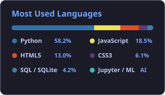
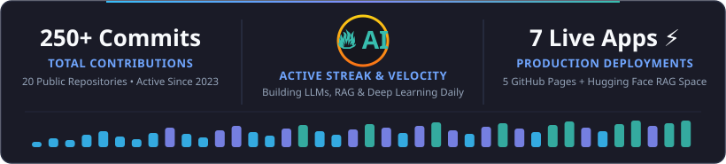

  

   

  # Hey there, I'm Praveen 👋
  ### AI/ML Engineer | Python Developer | Building Intelligent Applications

  

    I build practical applications using <b>Python</b>, <b>machine learning</b>, and <b>modern AI technologies</b>. 
    I'm exploring <b>LLMs</b>, <b>Retrieval-Augmented Generation (RAG)</b>, and <b>deep learning</b> to turn ideas into useful software.
  

  

    
    
    
    
    
  

---

## 🛠️ Tech Stack

### Languages

  
  
  

### AI & Machine Learning

  
  
  
  
  
  
  
  
  

### Web Development, Backend & Tools

  
  
  
  
  
  
  
  
  

---

## 🚀 Featured Projects

| Project | Description & Architecture | Tech Stack | Links |
| :--- | :--- | :--- | :---: |
| 🌐 **[Portfolio](https://github.com/praveen-79/praveen-portfolio)** | Personal 3D neural portfolio showcasing my projects, interactive system architecture blueprints, and an in-browser RAG AI terminal. | `HTML5` `CSS3` `JavaScript` `Three.js` | [Repo](https://github.com/praveen-79/praveen-portfolio) • [Live ↗](https://praveen-79.github.io/praveen-portfolio/) |
| 🤖 **[Coding Assistant](https://github.com/praveen-79/praveen-coding-assistant)** | AI coding assistant & PDF RAG chatbot powered by **Qwen 2.5 Coder 7B** and **SentenceTransformers** with cited sources and real-time token streaming. | `Python` `Flask` `Qwen 2.5` `RAG` | [Repo](https://github.com/praveen-79/praveen-coding-assistant) • [HF Space ↗](https://huggingface.co/spaces/praveenkumarpidamarthi/praveen-coding-assistant) |
| 🧠 **[EEG-to-Text](https://github.com/praveen-79/Thought-to-Text)** | AI research project exploring raw EEG brainwave signal-to-text conversion using a spatial-temporal **CNN-BiLSTM** deep learning pipeline and BLEU evaluation. | `Python` `PyTorch` `TensorFlow` `CNN-BiLSTM` | [Repo](https://github.com/praveen-79/Thought-to-Text) • [Blueprint ↗](https://praveen-79.github.io/praveen-portfolio/#projects) |
| 🛡️ **[DeepFakeDetection](https://github.com/praveen-79/DeepFakeDetection)** | End-to-end Deepfake Detection & **VeriShare** social platform combining **MesoNet**, **XceptionNet**, and **Vision Transformer (ViT)** 320-D feature fusion with Random Forest gating. | `Python` `TensorFlow` `ViT` `OpenCV` `Flask` | [Repo](https://github.com/praveen-79/DeepFakeDetection) • [Live ↗](https://praveen-79.github.io/DeepFakeDetection/) |
| 💬 **[PulseChat](https://github.com/praveen-79/pulsechat)** | Real-time multi-user chat application built with TCP socket programming, concurrent multithreaded client handling, SQLite authentication, and Tkinter GUI. | `Python` `Sockets` `Threading` `SQLite` `Tkinter` | [Repo](https://github.com/praveen-79/pulsechat) • [Live ↗](https://praveen-79.github.io/pulsechat/) |
| 🎵 **[Balu Beats](https://github.com/praveen-79/balu-beats)** | 320kbps music player & **Multi-App Spotify Bridge** featuring time-synced karaoke lyrics, 24/7 World Radio, PWA support, and React Native (Expo) mobile build. | `JavaScript` `HTML5 Audio` `React Native` `PWA` | [Repo](https://github.com/praveen-79/balu-beats) • [Live ↗](https://praveen-79.github.io/balu-beats/) |
| 📚 **[BookVerse Bookshop](https://github.com/praveen-79/bookshop)** | Full-stack online bookshop application with live jQuery/AJAX catalog search, dynamic cart synchronization, Werkzeug auth, and printable invoices. | `Python` `Flask` `SQLite` `jQuery` `AJAX` | [Repo](https://github.com/praveen-79/bookshop) • [Live ↗](https://praveen-79.github.io/bookshop/) |

---

## 📊 GitHub Statistics & Activity Streak

  
  

  

---

## 🎯 Currently Exploring

- 🧠 **Large Language Models (LLMs)** — Code generation, instruction tuning & Qwen 2.5 Coder workflows
- 🔍 **Retrieval-Augmented Generation (RAG)** — Dense vector embeddings, semantic chunking & citation-grounded synthesis
- ⚡ **AI Application Development** — Full-stack AI deployment with Flask, REST APIs & Hugging Face Spaces
- 🔬 **Machine Learning & Deep Learning** — Hybrid CNN-BiLSTM neural architectures, Vision Transformers (ViT) & multi-modal feature fusion
- 🎓 **Education** — **B.Tech in Artificial Intelligence & Machine Learning** @ *Chaitanya Bharathi Institute of Technology (CBIT), Hyderabad*

---

## 🤝 Connect With Me

  
  
  
  
  

  <i>Building, learning, and experimenting — one project at a time.</i>

